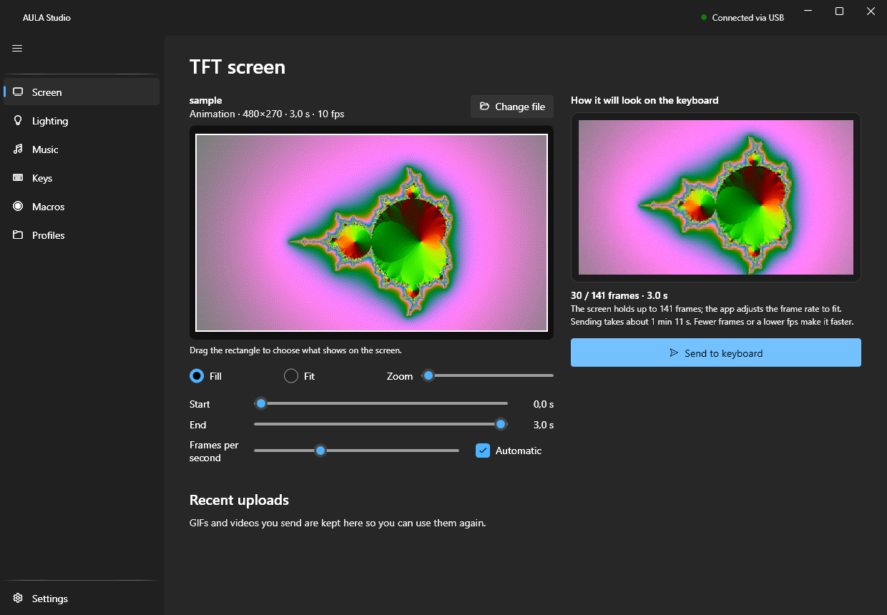
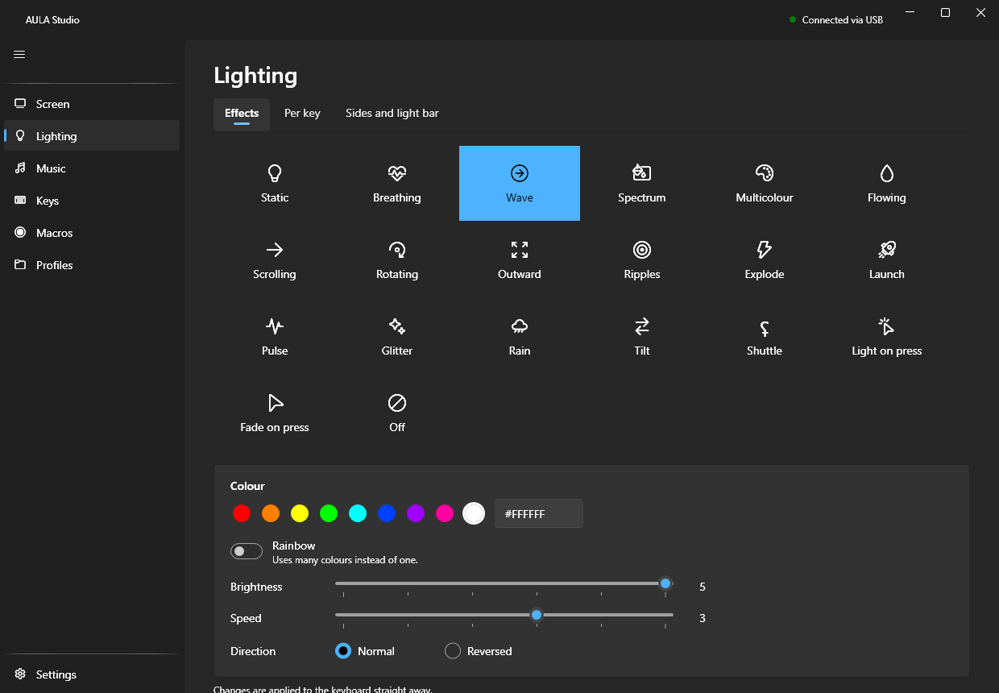
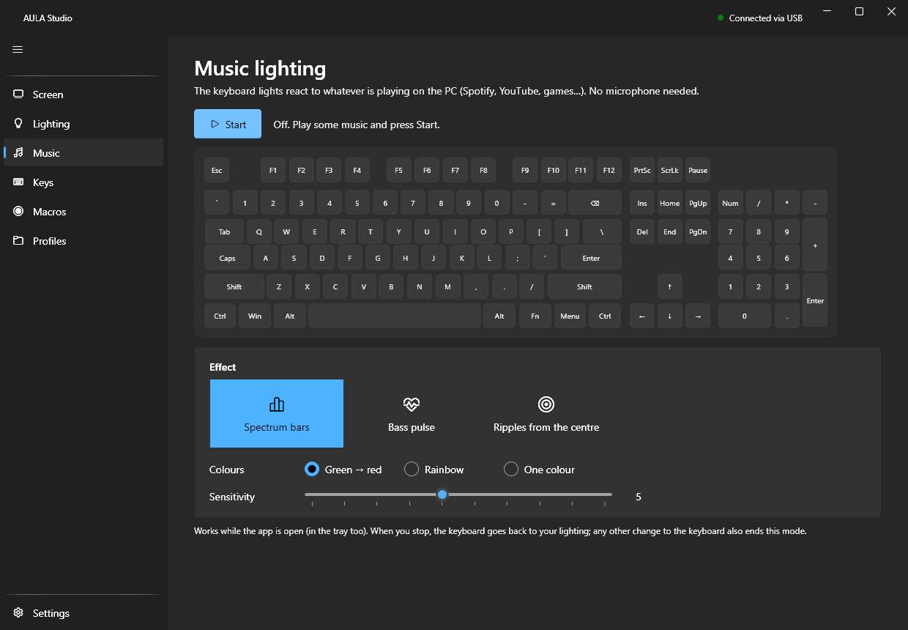
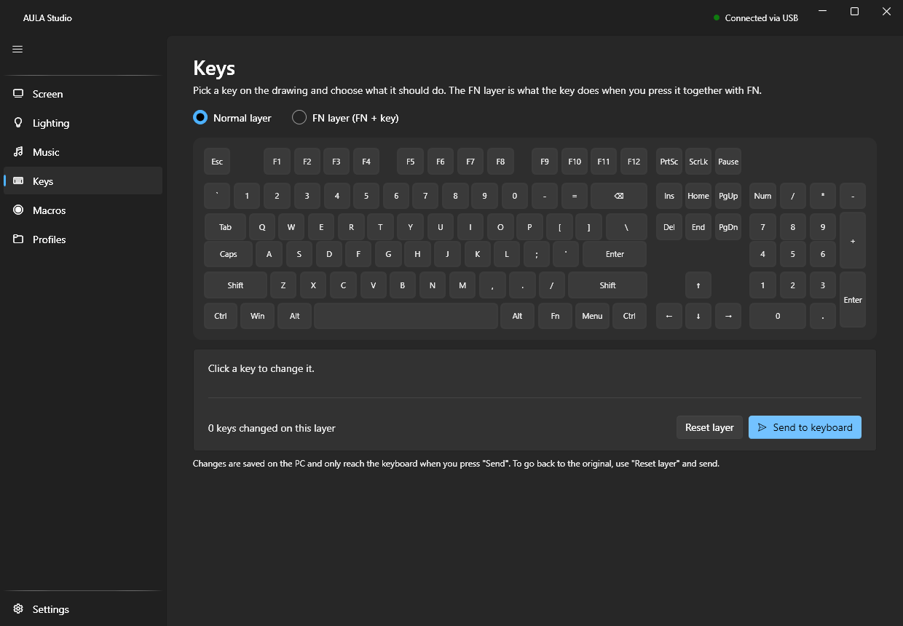
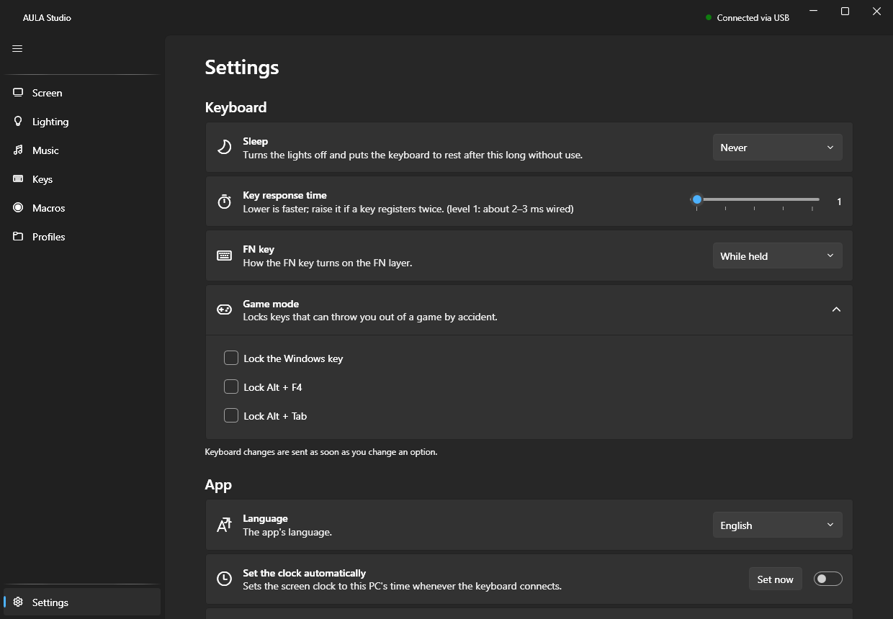

# AULA Studio

A simple, portable Windows app for the **AULA F108 Pro** keyboard: put GIFs and videos on its screen, control the lights, remap keys, record macros and make the keyboard react to music.

**[Download the latest version](https://github.com/bacoinz/aula-studio/releases/latest)** · [Português](#português)



> This is an unofficial project, not affiliated with AULA. It was built by studying how the keyboard's official app talks to the keyboard. Use it at your own risk.

## Features

- **Screen:** drag in a GIF, video or image, then crop, trim and preview it before sending it to the 240×135 screen. You can also compose an image with your own text, and reuse recent uploads.
- **Lighting:** all the keyboard's effects, per-key colours, and separate control of the sides and light bar.
- **Music lighting:** the keys react to whatever is playing on the PC. No microphone needed.
- **Keys:** remap keys on the normal and FN layers to other keys, mouse actions, media controls or macros.
- **Macros:** record sequences of keys and clicks that the keyboard plays by itself.
- **Profiles:** save a whole setup, and switch between setups with one click.
- **Keyboard options:** sleep time, key response time, FN behaviour, and locks for the Windows key, Alt+F4 and Alt+Tab.
- **Clock:** sets the screen clock from the PC whenever the keyboard connects.
- **Languages:** English and Portuguese.

| Lighting | Music lighting |
| --- | --- |
|  |  |

| Keys | Settings |
| --- | --- |
|  |  |

## Try it

1. Close the official AULA app, because only one app can talk to the keyboard at a time.
2. Connect the keyboard with the **USB cable**.
3. Download `AulaStudio-Portable-1.0.0.zip` from the [releases page](https://github.com/bacoinz/aula-studio/releases/latest).
4. Unzip it to any folder you can write to (not `Program Files`) and open `AulaStudio.exe`.

Nothing is installed, and you don't need .NET or FFmpeg. To remove the app, delete the folder. Your settings stay in a `data` folder next to the exe.

The app isn't digitally signed, so Windows may show a SmartScreen warning. To run it anyway, choose **More info**, then **Run anyway**.

## Compatibility

| | |
| --- | --- |
| Keyboard | **AULA F108 Pro only** (USB ID `0C45:800A`) |
| Connection | USB cable only; 2.4 GHz and Bluetooth aren't supported |
| System | Windows x64; tested on Windows 11 only |

Other AULA keyboards aren't detected.

## Have a different AULA keyboard? Ask an AI to adapt it

The app only works with the F108 Pro, but you can give this repository to an AI coding agent, such as [Claude Code](https://claude.com/claude-code) or [Codex](https://openai.com/codex/), and ask it to adapt the app to your keyboard. Other models may use the same commands, or they may need new ones worked out, so the result isn't guaranteed.

Your keyboard doesn't have to be an AULA: you can also try adapting the code to another brand. Expect more work, because another brand is more likely to use different commands.

You'll need your keyboard and its official app, which the agent can study to see how your model differs. A prompt to start with:

```text
This repository is an app for the AULA F108 Pro keyboard. I want to adapt it to my
AULA [your model]. Its official app is installed at [folder].

Read docs/protocol.md first. Then compare my keyboard with the F108 Pro: USB IDs,
HID interfaces, commands, key and light layout, and screen size, if it has one.
Explain what differs before changing anything. Test with read-only commands first,
and ask me before sending anything that writes to the keyboard's memory.
```

These are the main places an agent will need to look:

| What | Where |
| --- | --- |
| The USB protocol, as worked out for the F108 Pro | [`docs/protocol.md`](docs/protocol.md) |
| USB IDs used to detect the keyboard | [`src/Aula.Protocol/WindowsHidTransport.cs`](src/Aula.Protocol/WindowsHidTransport.cs) |
| Commands and how they're sent | [`src/Aula.Protocol`](src/Aula.Protocol) |
| Key positions and light numbers | [`src/AulaStudio/Assets/f108pro-layout.json`](src/AulaStudio/Assets/f108pro-layout.json) |
| Screen format and frame limit | [`src/Aula.Protocol/LcdImage.cs`](src/Aula.Protocol/LcdImage.cs) |
| Command-line tool for testing commands | [`tools/aula-cli`](tools/aula-cli) |

**Be careful with writes.** Wrong commands could misconfigure a keyboard, especially the ones that write to its memory. On the F108 Pro, this app never sends more than 141 screen frames, which is the screen's limit; don't assume that limit applies to another model.

## Build from source

You need the [.NET 10 SDK](https://dotnet.microsoft.com/download/dotnet/10.0) on Windows.

```bash
dotnet build AulaStudio.sln
```

```bash
dotnet test AulaStudio.sln
```

```bash
dotnet run --project src/AulaStudio
```

GIF and video conversion needs FFmpeg on your `PATH`, or in an `ffmpeg` folder next to the exe. [`portable/README.md`](portable/README.md) explains how to build the small FFmpeg and the portable zip.

## Licence

AULA Studio is released under the [MIT Licence](LICENSE). The portable build includes third-party software, including FFmpeg under the LGPL; see [`portable/THIRD-PARTY.txt`](portable/THIRD-PARTY.txt). "AULA" and "F108 Pro" are used only to name the keyboard this app works with.

---

## Português

Uma app portátil e simples para Windows, feita para o teclado **AULA F108 Pro**. Põe GIFs e vídeos no ecrã, controla as luzes, remapeia teclas, grava macros e faz o teclado reagir à música.

Este projeto não é oficial nem tem ligação à AULA. Foi feito a estudar a forma como a app oficial comunica com o teclado, por isso usa-o por tua conta e risco.

### Experimentar

1. Fecha a app oficial da AULA, porque só uma app de cada vez pode comunicar com o teclado.
2. Liga o teclado com o **cabo USB**.
3. Descarrega o `AulaStudio-Portable-1.0.0.zip` da [página de versões](https://github.com/bacoinz/aula-studio/releases/latest).
4. Descompacta-o para uma pasta onde possas escrever (não em `Program Files`) e abre o `AulaStudio.exe`.

Não instala nada, nem precisas de .NET ou FFmpeg. Para remover a app, apaga a pasta. As definições ficam numa pasta `data` ao lado do exe.

A app não tem assinatura digital, por isso o Windows pode mostrar um aviso do SmartScreen. Para a abrir na mesma, escolhe **Mais informações** e depois **Executar mesmo assim**.

### Tens outro teclado AULA?

A app só funciona com o F108 Pro e por cabo USB. Mas podes dar este repositório a um agente de IA, como o [Claude Code](https://claude.com/claude-code) ou o [Codex](https://openai.com/codex/), e pedir-lhe que o adapte ao teu teclado. Outros modelos podem usar os mesmos comandos ou precisar de novos, por isso o resultado não é garantido.

O teclado nem precisa de ser AULA: também podes experimentar adaptar o código a outra marca. Conta com mais trabalho, porque é mais provável que outra marca use comandos diferentes.

Vais precisar do teclado e da app oficial dele, que o agente pode estudar para ver o que muda. Para começar, podes escrever:

```text
Este repositório é uma app para o teclado AULA F108 Pro. Quero adaptá-la ao meu
AULA [o teu modelo]. A app oficial está instalada em [pasta].

Lê primeiro o docs/protocol.md. Depois compara o meu teclado com o F108 Pro: IDs USB,
interfaces HID, comandos, disposição das teclas e das luzes, e tamanho do ecrã, se
tiver. Explica o que muda antes de alterares alguma coisa. Testa primeiro com comandos
só de leitura, e pergunta-me antes de enviares algo que grave na memória do teclado.
```

A [secção em inglês](#have-a-different-aula-keyboard-ask-an-ai-to-adapt-it) indica os ficheiros mais importantes para o agente. Tem cuidado com as gravações: comandos errados podem desconfigurar o teclado, sobretudo os que escrevem na memória dele.
